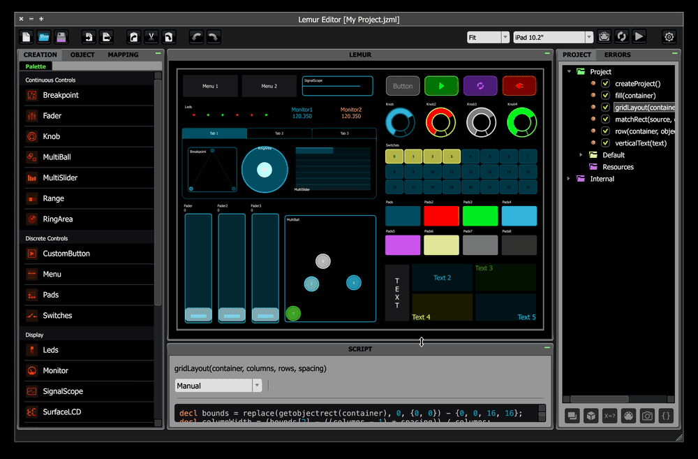
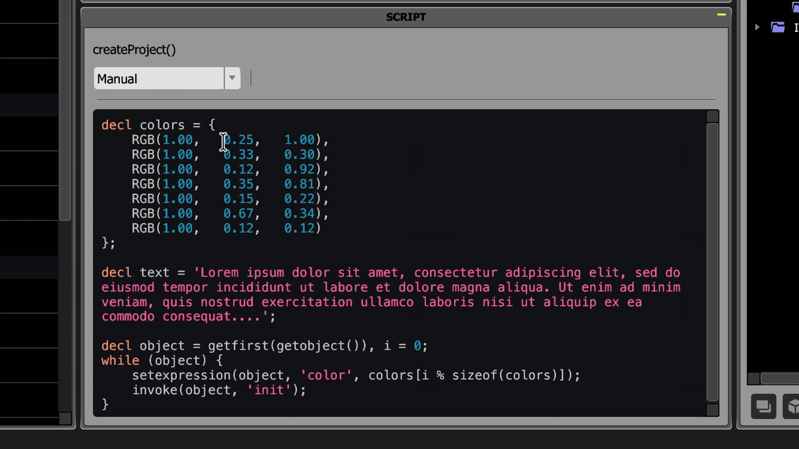
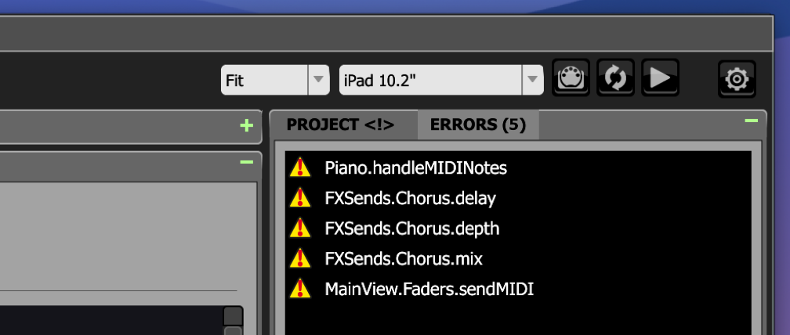
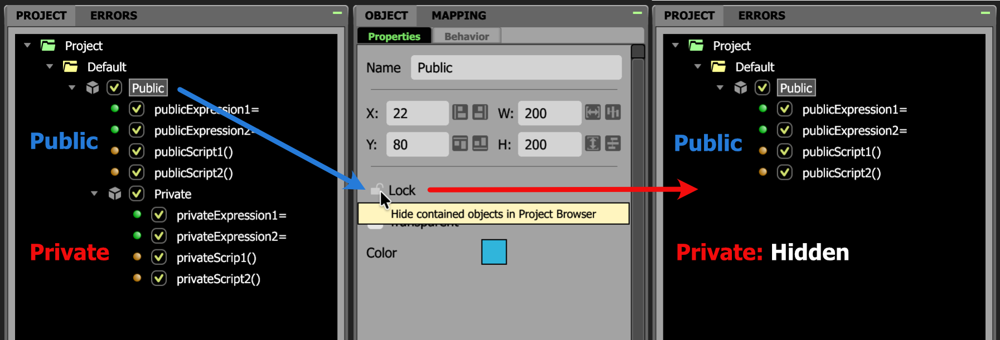
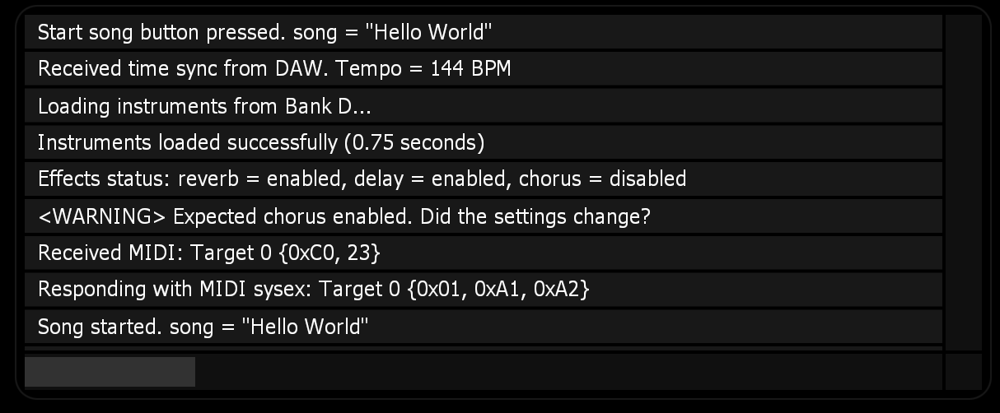
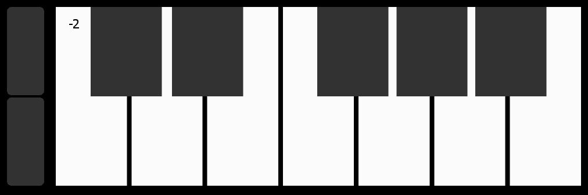
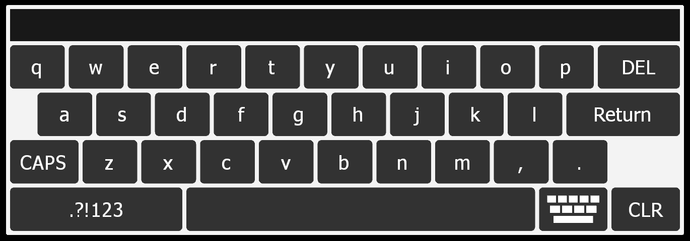

# Lemur Changelog

## Lemur 5.8

August 29, 2026

### Improvements to the Lemur Editor

#### Zoomable Canvas

The project canvas can now be zoomed in and out or scaled to fit the available space. 

  

> Use `Cmd/Ctrl` + `+` and `Cmd/Ctrl` + `-` to zoom, or `Cmd/Ctrl` + `0` to zoom to fit.

#### New Code Editor

Lemur 5.8 includes an all-new dark-mode code editor with proper support for line wrapping, multi-column selections, and multiple font sizes.

  

> Use `Cmd/Ctrl` + `+` and `Cmd/Ctrl` + `-` to change the font size.

#### New Compiler Error Panel

A new Error Panel displays a list of all scripts and expressions that currently report errors, avoiding the need to search through the entire project—or worse, never realizing that errors were present at all.

  
  
#### Editor Layout Improvements

Lemur 5.8 includes a broad set of visual and layout improvements throughout the Editor, with more consistent alignment, spacing, and behavior. A number of panels have also been redesigned to improve their individual layouts. Some of the more noticeable improvements include:

- All inspector panels are now scrollable, allowing you to see all their contents without constantly requiring you to resize or close unused dock tabs. 
- Resizing the Lemur Editor now correctly causes the project canvas to grow, rather than the sidebar panels, avoiding the need to resize the sidebars every time you resize the window.


#### Modernized Text Rendering Engine

Lemur's text rendering pipeline has been rewritten from the ground up to provide modern, crisp, consistent, high-performance text across font sizes, display sizes, and operating systems.

#### Rename Scripts and Expressions in Place

Scripts and expressions can now be renamed directly, without having to go through the tedious process of copying their contents, deleting them, and recreating them under a new name. One of our most requested features!

  > Right-click the script or expression in the Project Navigator and select **Rename**.

#### Improved Multi-Monitor and Display-Scale Support

The Lemur Editor now handles multi-monitor systems with mixed resolutions, layouts, and fractional display scales. This resolves one of the Editor's oldest bugs, which could leave the Editor unresponsive or outside the visible display area.

<br>

### Additions to the Lemur Scripting Language

#### Dynamic Script Execution: `invoke`

The new `invoke` family of functions allows you to execute a script simply by mentioning its name as a string:

- **`invoke(object, name)`**

  Executes the script `name` on `object` and returns its result. Silently fails and returns 0 if the script doesn't exist.

   ```lemurscript
   // Example:
   decl result = invoke(object, 'sendMIDI');
   ```	


The invoke family of functions also provides variations that allow arguments (up to 8):
- **`invoke1(object, name, arg1);`**
- **`invoke2(object, name, arg1, arg2);`**
- **`invoke3(object, name, arg1, arg2, arg3);`**
- **`invoke4(object, name, arg1, arg2, arg3, arg4);`**
- **`invoke5(object, name, arg1, arg2, arg3, arg4, arg5);`**
- **`invoke6(object, name, arg1, arg2, arg3, arg4, arg5, arg6);`**
- **`invoke7(object, name, arg1, arg2, arg3, arg4, arg5, arg6, arg7);`**
- **`invoke8(object, name, arg1, arg2, arg3, arg4, arg5, arg6, arg7, arg8);`**


    ```lemurscript
    // Example
    invoke2(multiball, 'sendMIDI', 1, 11);
    ```

---
#### Completing Lemur's Support for Dynamic Object Access

The new `invoke` family fills a longstanding gap in how Lemur works with object references.

Typically, Lemur can only access an expression or execute a script if it has a direct, named reference to an object. However, once the object is stored in a variable, its object-specific members can no longer be accessed directly:

```lemurscript
Fader.x = 0.5; // ✅ OK
Fader.reset(0.5); // ✅ OK

decl object = Fader; // Store a reference to Fader
object.x = 0.5; // ❌ Doesn't compile: `object` has no member named 'x'
object.reset(0.5); // ❌ Doesn't compile: `object` has no script named `reset`
```

To get around this, Lemur has always supported dynamic expression access through the functions `getexpression` and `setexpression`. However, there was no equivalent way to execute a script:

```lemurscript
decl object = Fader;
decl x = getexpression(object, 'x'); // ✅ OK
setexpression(object, 'x', 0.5); // ✅ OK
object.reset(0.5); // ❌ Doesn't compile: `object` has no script named `reset`
```

The `invoke` family closes this gap by adding dynamic script execution:

```lemurscript
decl object = Fader;
invoke1(object, 'reset', 0.5); // ✅ OK
```

Together, these functions enable a dynamic programming style similar to [**Duck Typing**](https://en.wikipedia.org/wiki/Duck_typing). As long as an object provides an expression or script with the requested name, your code can use it without knowing the object’s concrete type.

#### New Patterns

This dynamic object access also enables programming patterns that were previously difficult to express in Lemur, such as:

#### 1. Dynamic Dispatch

Objects of different types can implement a script with the same name and be called uniformly: 

```lemurscript
decl objects = {Fader, Switches, Pads, MultiBall};
decl i;
for (i = 0; i < sizeof(objects); i++) {
  invoke(objects[i], 'sendMIDI');
}
```

#### 2. Completion Handlers

Pass a script to be executed by another script:

```lemurscript
Pads {
  onPadsPressed() {
    // Pass the completion object and script name to the Knob.
    Knob.spin(Text, 'display');
  }
}

Knob {
  spin(completionObject, completionScript) {
    x = rand();
    // Execute the supplied script
    invoke1(completionObject, completionScript, 'Knob = ' + x);
  }
}

Text {
  display(value) {
    setattribute(getobject(), 'content', value);
  }
}
```

#### 3. Strategy Pattern

Swap out behavior at runtime by storing the name of the script to be executed later:

```lemurscript
Pads {
  script=
  onPadsPressed() { invoke(getobject(), script); }
  sendNote() { noteout(0, 1, 127, 1); }
  sendControlChange() { ctlout(0, 1, 127, 1); }
  sendProgramChange() { programchangeout(0, 1, 1); }
}

// Load the button press with different behaviors
Pads.script = 'sendNote';
Pads.script = 'sendControlChange';
Pads.script = 'sendProgramChange';
```

#### 4. State Pattern

Each state implements the same set of event handlers. The parent object delegates events to the currently active state:

```
Piano {
    IdleState {
        buttonPressed() { }
        buttonReleased() { }
        enter() { }
    }

    ActiveState {
        buttonPressed() { noteOn(); }
        buttonReleased() { noteOff(); }
        enter() {
            redrawKeys();
        }
    }

    EditingState {
        buttonPressed() { showEditor(); }
        buttonReleased() { }
        enter() {
            redrawKeys();
        }
    }

    state = IdleState;

    buttonPressed() {
        invoke(state, 'buttonPressed');
    }

    setState(newState) {
        state = newState;
        invoke(state, 'enter');
    }
}
```


#### 5. Command Pattern

Create a queue of named actions and execute them in order:

```lemurscript
decl commands = {'send_cc', 'send_cc', 'send_note', 'send_note'};
decl i;
for (i = 0; i < sizeof(scripts); i++) {
    invoke(object, commands[i]);
}
```

These are only a few examples of the patterns enabled by dynamic script execution.

<br>

### Changes to Object Behavior

#### Locked Containers

Locking a container no longer prevents it from being resized or receiving touch input.

Find out more here, in this discussion: https://community.midikinetics.com/viewtopic.php?t=6176&sid=b78ccb1fd672994e73d650ac0f8fcd9a

##### Thinking about distributing a Lemur module?

Containers provide a practical way to distribute a Lemur module while hiding its internal implementation details.

Place the module's internal objects inside a child container, then lock the parent container. The child container is hidden from the Project Navigator, while scripts and expressions on the parent remain visible.

The parent container exposes the module's **public API**, while the hidden child container contains its **private implementation details**.




#### MIDI Mapping Trigger Rules

MIDI mapping trigger conditions can now be evaluated using either the source expression or the scaled MIDI value. Scaling still determines the value sent; the trigger rule determines which value is observed for changes.

This allows fixed-value mappings, such as Program Change and SysEx, to send the same mapped value each time the source expression changes, even when the generated MIDI value remains constant.

> Select **Project** and open **Mapping > MIDI** to choose **Source Expression** or **Scaled MIDI Value**. New projects default to **Source Expression**. Existing projects retain **Scaled MIDI Value** for compatibility unless the setting is changed.

### Performance and Stability

- **Network Stability:** Device discovery and connection handling are more reliable when using multiple USB and Wi-Fi devices at the same time, especially when Lemur is running on several mobile devices.

- **Frame-Rate Stability:** An issue that could produce unpredictable Editor frame rates has been resolved. The Lemur Editor and Lemur app now maintain a consistent 60 FPS.

- **Runtime Performance and Stability:** Work throughout the Lemur Editor and Lemur app reduces CPU, GPU, and battery use. Lemur 5.8 also includes numerous fixes to general responsiveness and runtime stability.


### And many more

Lemur 5.8 contains many bug fixes and performance improvements under the hood.

<br>

## Lemur 5.8.1 Addendum (iOS)

August 30, 2026

- Fixed a crash on launch affecting devices with A9 and A9X processors
- Added support for transferring Lemur projects using the iOS Share Sheet

> Long press one of your projects or swipe left and press "Share"

<br>

## Lemur 5.7

Nov 4, 2024

## Script Editor Improvements

- **Undo/Redo:** The most requested feature! You can now undo changes in the script editor. Each script maintains its own separate undo history. This ensures that undoing changes in one script won’t affect another. Additionally, undo actions are tracked separately for UI and script editor changes, ensuring undo actions remain specific to where they occurred.
- **Comment/Uncomment Selection:** Use the keyboard shortcut  `CMD/CTL + \` to toggle code comments on/off. Works on both single and multiple lines.
- **Tab-Indent Selection:** Use the keyboard shorcut `CMD/CTL [ or ]` to tab-indent code. Works on both single and multiple lines.


## Improvements to Lemur Editor

- **Updated Lemur default project sizes to reflect modern iOS devices:** iPad 9.7", iPad 10.2", iPad 10.9", iPad 12.9", iPhone 12, iPhone 14 Pro Max


## Additions to LemurLang

#### String Functions

Lemur 5.7 implements important text functions, completing the essential infrastructure for full text processing in LemurLang. 

- `stringtoarray(s)`

    Returns an array of ANSI-encoded characters for a given string or 0 if the conversion fails. 
    
    ```
    stringtoarray('Hello'); // {72, 101, 108, 108, 111}
    stringtoarray(MyButton); // 0
    ```
    
    You can now easily perform tasks like sending text as SysEx messages:
    
    ```
    // Sends the message 'Start Song' as sysex data to Lemur Target 0
    sysexout(0, stringtoarray('Start Song'));
    ```
    
    Or, perhaps apply auto-capilization rules:
    
    ```
    decl lowercase = 'hello';
    decl uppercase = arraytostring(stringtoarray(lowercase) - 32); //     'HELLO';
    ```
    
    For a reference of ANSI-encoded characters, see [this link](https://www.ascii-code.com). 

- `stringtonumber(s)`

    Returns a string converted to a number, or the empty string if conversion failed.
    
    ```
    stringtonumber(100); // 100
    stringtonumber('hello'); // ''
    ```

#### MIDI Related Functions

Lemur 5.7 implements new convenience methods for sending different MIDI messages, which previously required manually sending them as raw MIDI bytes.

    
- `programchangeout(target, pgm, chan)`

    Sends a MIDI program change message out Lemur target `target`, with data-byte 1 `pgm`, on MIDI channel `chan`.
    
- `channelpressureout(target, pressure, chan)`

    Sends a MIDI channel pressure message out Lemur target `target`with data-byte 1 `pressure`, on MIDI channel `chan`.
    
- `polypressureout(target, note, pressure, chan)`

    Sends a MIDI poly pressure message out Lemur target `target` with data-byte 1 `note` and data-byte 2 `pressure` on MIDI channel `chan`.
    
- `pitchbendout(target, value, min, max, chan)`

    Sends a MIDI pitchbend message on Lemur target `target`, with value `value`, where `value` represents a value in the range of `min` and `max` on MIDI channel `chan`.
    
    Common ranges for `min` and `max`:
    
    - `min` = 0, `max` = 1 (center = 0.5)

        Useful for Lemur fader widgets who specify their position as a floating point number between 0 and 1. The center is at 0.5.
        
        Example:
        
        `pitchbendout(0, Fader.x, 0, 1, 1)`
    
    - `min` = -1, `max` = 1 (center = 0)
    - `min` = 0, `max` = 16383 (center = 8192)
    - `min` = -8192, `max` = 8191 (center = 0)

- `sysexout(target, databytes[])`

    Sends a MIDI sysex message out Lemur target `target` with the supplied `dataBytes`. 
    
    Note:
    - You do not need to specify the sysex-start or sysex-end data bytes. These will be added to the message before it is sent if they are not already added.
    - Data bytes are currently limited to 128 values.

    Example:
    
    ```
    sysexout(0, {0, 0, 11, 12});
    ```

## Bug Fixes

- Fixed an issue with the Image Widget resizing unexpectedly when Resize Mode is set to Lock Ratio.
- Fixed the Lemur Editor window becoming unreachable on multi-monitor setups.


## Downloadable Lemur Modules

### MKConsole

A text console for logging debug messages.



Features:

- Auto-resizes.
- Double-tap to clear, or clear programmatically. 
- Customize colors and font sizes.

[Download Here](https://github.com/MIDIKinetics/MKConsole)

--- 

### MKPiano

A fully customizable, 128 key piano widget.



Features:

- Auto-resizes 
- Respond to key presses and releases.
- The higher you tap on the key the greater the velocity.
- Adjustable number of visible octaves.
- Configurable scrolling behavior (octave or page-based).
- Option to show/hide/reposition scroll buttons.
- Disable scrolling animations.
- Add custom labels to each key and control text color.
- Customize key colors.
- Enable full programmatic control by disabling key presses.

[Download Here](https://github.com/MIDIKinetics/MKPiano)

--- 

### MKQwerty

Add a QWERTY keyboard to your Lemur project to enable in-app text editing.



Features:

- Auto-resizes.
- Choose between alphanumeric or numeric output.
- Limit input to integers, floats, or positive numbers.
- Show/Hide Return key.
- Show/Hide Dismiss key.
- Show/Hide output display.
- Monitor output and keystrokes.
- Set input programmatically.
- Customizable colors and text size


[Download Here](https://github.com/MIDIKinetics/MKQwerty)

